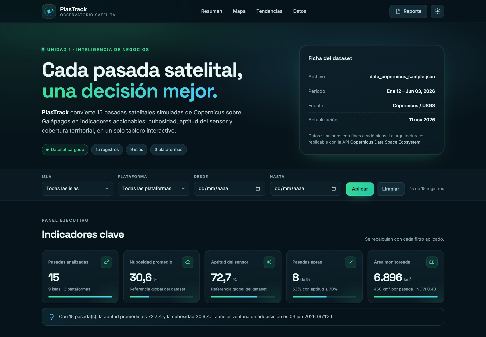

# PlasTrack

**Observatorio satelital de Galápagos · Dashboard de inteligencia de negocios**

Benchmarking de herramientas BI y prototipado de un tablero analítico con IA generativa para el
monitoreo de pasadas satelitales sobre el archipiélago de Galápagos. Actividad cooperativa de la
Unidad 1 — Inteligencia de Negocios, Universidad Técnica de Cotopaxi.

[](#pruebas)
[](#accesibilidad-y-rendimiento)
[](LICENSE)
[](https://carlos00012.github.io/plastrack/)



---

## Tabla de contenidos

1. [El problema](#el-problema)
2. [La solución](#la-solución)
3. [Demo](#demo)
4. [Stack tecnológico](#stack-tecnológico)
5. [Estructura del repositorio](#estructura-del-repositorio)
6. [Dataset y diccionario de datos](#dataset-y-diccionario-de-datos)
7. [Metodología del benchmarking](#metodología-del-benchmarking)
8. [Indicadores (KPIs)](#indicadores-kpis)
9. [Resultados del dataset](#resultados-del-dataset)
10. [Ejecución local](#ejecución-local)
11. [Pruebas](#pruebas)
12. [Documentación generada](#documentación-generada)
13. [Accesibilidad y rendimiento](#accesibilidad-y-rendimiento)
14. [Despliegue en GitHub Pages](#despliegue-en-github-pages)
15. [Autoría y licencia](#autoría-y-licencia)

---

## El problema

Copernicus y Landsat publican escenas multiespectrales de Galápagos de forma abierta y sistemática.
Sin embargo, **disponibilidad de datos no equivale a capacidad de decisión**: los archivos crudos
exigen selección, limpieza, agregación y representación visual antes de responder preguntas
operativas como *¿qué pasadas son útiles para estimar cobertura vegetal?*, *¿en qué isla conviene
concentrar el esfuerzo de campo?* o *¿cómo evoluciona la nubosidad entre enero y junio?*.

El proyecto resuelve esa brecha con dos entregables complementarios: un **informe técnico
consolidado** que justifica la herramienta elegida mediante un benchmarking ponderado y un
**dashboard funcional** que materializa los indicadores sobre datos simulados reproducibles.

## La solución

**PlasTrack** es una aplicación web estática, responsiva y accesible que consume un archivo JSON
local, sin backend ni base de datos, y ofrece:

- **Cinco tarjetas KPI** con contexto y variación respecto al promedio.
- **Mapa interactivo Leaflet** con marcadores por pasada, capa de calor, zonas de acumulación y
  línea base satelital, sobre imágenes Esri World Imagery.
- **Cuatro visualizaciones Chart.js**: evolución mensual de nubosidad y aptitud, ranking de islas,
  dispersión nubosidad–aptitud con recta de regresión y distribución por plataforma.
- **Tabla auditable** ordenable, filtrable, buscable y exportable a CSV.
- **Filtros globales** por isla, plataforma, rango de fechas y umbral de aptitud, con estado
  vacío explicativo y restablecimiento en un clic.
- **Tema oscuro por defecto** y conmutador a tema claro, persistido en `localStorage`.

Toda la lógica analítica (`assets/js/analytics.js`) es pura y está cubierta por pruebas, de modo que
el dashboard y los documentos oficiales se calculan con **el mismo núcleo**, sin cifras
inconsistentes entre entregables.

## Demo

> **Sitio publicado:** <https://carlos00012.github.io/plastrack/>

También puede abrirse sin conexión ejecutando un servidor local (ver [Ejecución
local](#ejecución-local)); el dashboard solo requiere red para las fuentes tipográficas, Leaflet,
Chart.js y las teselas del mapa.

## Stack tecnológico

| Capa | Tecnología | Versión | Rol |
|---|---|---|---|
| Estructura | HTML5 semántico | — | Landmarks, jerarquía de encabezados, ARIA |
| Estilos | CSS3 con variables y *container queries* | — | Sistema de diseño, temas, responsividad |
| Lógica | JavaScript ES2022 (módulos ESM) | — | Estado, filtros, renderizado, exportación |
| Mapas | [Leaflet](https://leafletjs.com/) + Leaflet.heat | 1.9.4 / 0.2.0 | Mapa interactivo y capa de calor |
| Gráficos | [Chart.js](https://www.chartjs.org/) | 4.4.3 | Cuatro visualizaciones responsivas |
| Datos | JSON estático | — | 15 registros simulados, 16 campos |
| Documentos | Puppeteer + `pdf-lib` + `docx` | 23 / 1.17 / 9 | PDF y DOCX generados desde un modelo único |
| Pruebas | `node:test` | Node ≥ 20 | 12 pruebas unitarias del núcleo analítico |
| Despliegue | GitHub Pages | — | Hosting estático gratuito con HTTPS |

No hay dependencias de ejecución instalables: el sitio se sirve tal cual. Las dependencias de
`package.json` solo se usan para **generar la documentación** y ejecutar las pruebas.

## Estructura del repositorio

```
plastrack/
├── index.html                     # Documento único del dashboard
├── assets/
│   ├── css/styles.css             # Sistema de diseño, temas y responsive
│   ├── img/                       # Favicon y tarjeta Open Graph
│   └── js/
│       ├── analytics.js           # Núcleo puro: KPIs, Pearson, regresión, CSV
│       ├── app.js                 # Controlador: estado, filtros, tabla, exportación
│       ├── charts.js              # Renderizado Chart.js y re-tema
│       ├── format.js              # Formateadores es-EC
│       └── map.js                 # Leaflet: marcadores, calor, zonas
├── data/
│   └── data_copernicus_sample.json  # Dataset de 15 pasadas satelitales
├── docs/
│   ├── Reporte_Tecnico_PlasTrack.pdf/.docx
│   ├── Memoria_de_Construccion.pdf/.docx
│   └── figuras/                   # Arquitectura y capturas del dashboard
├── scripts/
│   ├── content/                   # Modelo de contenido del informe y la memoria
│   ├── lib/                       # Renderizadores HTML/DOCX y estadística
│   ├── build-docs.mjs             # Genera PDF + DOCX
│   ├── build-figures.mjs          # Captura las figuras con Chrome
│   └── serve.mjs                  # Servidor estático local
├── tests/analytics.test.mjs       # 12 pruebas unitarias
├── .github/workflows/             # CI y despliegue a Pages
├── LICENSE
└── package.json
```

## Dataset y diccionario de datos

`data/data_copernicus_sample.json` contiene **15 registros simulados** de pasadas satelitales entre
enero y junio de 2026 sobre **nueve islas** y **tres plataformas** (Sentinel-2A, Sentinel-2B y
Landsat 9). Los datos son sintéticos y reproducibles: se diseñaron con coherencia estacional
(menor nubosidad de mayo a junio) y una relación inversa deliberada entre nubosidad y aptitud del
sensor, de modo que el ejercicio analítico sea realista sin depender de una descarga externa.

| Campo | Tipo | Unidad | Descripción |
|---|---|---|---|
| `id` | string | — | Identificador único de la pasada (`COP-2026-###`) |
| `satelite` | string | — | Plataforma: Sentinel-2A, Sentinel-2B o Landsat 9 |
| `sensor` | string | — | Instrumento: MSI u OLI-2 |
| `fecha` | string | ISO 8601 | Fecha de adquisición (`AAAA-MM-DD`) |
| `hora_utc` | string | UTC | Hora de paso del satélite |
| `isla` | string | — | Isla objetivo de la observación |
| `zona` | string | — | Zona o accidente geográfico de interés |
| `lat` / `lon` | number | grados | Centroide de la escena |
| `nubosidad_pct` | number | % | Cobertura nubosa de la escena |
| `aptitud_pct` | number | % | Aptitud operativa del sensor (0–100) |
| `ndvi_promedio` | number | índice | NDVI promedio de la escena (−1 a 1) |
| `area_km2` | number | km² | Área observada |
| `temperatura_superficie_c` | number | °C | Temperatura superficial estimada |
| `resolucion_m` | number | m | Resolución espacial (10 m MSI, 30 m OLI-2) |
| `fuente` | string | — | Origen declarado del dato |

## Metodología del benchmarking

Se compararon cuatro alternativas sobre **ocho criterios ponderados** (suma de pesos = 100%) y una
escala de 1 a 5. La puntuación final es la suma de `peso × valor`.

| Criterio | Peso | Power BI | Looker Studio | Tableau | Stack web |
|---|---:|---:|---:|---:|---:|
| Capas geoespaciales y mapas de calor | 20% | 4 | 3 | 4 | 5 |
| Integración con JSON/CSV | 15% | 4 | 4 | 4 | 5 |
| Costo total de licenciamiento | 15% | 2 | 5 | 1 | 5 |
| Usabilidad y curva de aprendizaje | 15% | 4 | 5 | 3 | 4 |
| Rendimiento web | 15% | 3 | 4 | 3 | 5 |
| Diseño responsivo | 10% | 3 | 4 | 3 | 5 |
| Despliegue público | 5% | 2 | 4 | 3 | 5 |
| Ecosistema y soporte | 5% | 5 | 4 | 5 | 4 |
| **Puntuación ponderada** | **100%** | **3,40** | **4,10** | **3,15** | **4,80** |

La ponderación se fijó antes de puntuar para evitar sesgos de confirmación. El anexo C del informe
desarrolla el cálculo fila por fila y el análisis de sensibilidad.

El stack web (Leaflet.js + Chart.js) obtiene **4,80/5,00**, seguido de Looker Studio (4,10), Power BI
(3,40) y Tableau (3,15). El detalle de la ponderación, el análisis de sensibilidad y la
justificación de la alternativa elegida están en el informe técnico.

## Indicadores (KPIs)

| KPI | Definición | Lectura |
|---|---|---|
| Nubosidad media | Media aritmética de `nubosidad_pct` | Menor es mejor |
| Aptitud media del sensor | Media de `aptitud_pct` | Mayor es mejor |
| Pasadas aptas | Registros con `aptitud_pct ≥ 70` | Volumen operativo |
| Área observada | Suma de `area_km2` | Cobertura del monitoreo |
| Brecha de equidad | Diferencia entre la isla mejor y la peor puntuada | Equidad territorial |

El umbral operativo de **70% de aptitud** se usa además como filtro interactivo y como criterio de
color de los marcadores del mapa.

## Resultados del dataset

| Indicador | Valor |
|---|---|
| Nubosidad media | 30,65% |
| Aptitud media | 72,67% |
| Pasadas aptas (≥ 70%) | 8 de 15 (53,3%) |
| Área observada | 6.896,1 km² |
| NDVI promedio | 0,484 |
| Correlación nubosidad–aptitud | r = −0,9988 |
| Pendiente de regresión | −1,2245 puntos de aptitud por punto de nubosidad |
| Brecha de equidad entre islas | 38,9 pp |
| Isla mejor puntuada | Baltra (94,8) |
| Isla peor puntuada | Floreana (55,9) |

Serie mensual (nubosidad % / aptitud %): enero 35,5 / 66,4 · febrero 43,6 / 56,6 · marzo 35,1 /
67,4 · abril 26,7 / 78,1 · mayo 13,9 / 93,6 · junio 9,4 / 97,1.

## Ejecución local

Requiere **Node.js ≥ 20** (probado con v24) y, para regenerar documentos, Google Chrome.

```bash
git clone https://github.com/carlos00012/plastrack.git
cd plastrack
npm install          # solo para pruebas y generación de documentos
npm run serve        # http://localhost:8123
```

El servidor estático es necesario porque el dashboard usa módulos ES y `fetch` del JSON, que los
navegadores bloquean sobre `file://`.

Comandos disponibles:

| Comando | Efecto |
|---|---|
| `npm run serve` | Sirve el sitio en `http://localhost:8123` |
| `npm test` | Ejecuta las 12 pruebas del núcleo analítico |
| `npm run build:docs` | Regenera los PDF y DOCX en `docs/` |
| `npm run build:figures` | Recaptura las figuras del dashboard (requiere el servidor activo) |

## Pruebas

```bash
npm test
```

12 pruebas unitarias sobre funciones puras: media, correlación de Pearson (perfecta, inversa y
degenerada), regresión lineal, KPIs, agregación por isla, filtros combinados, umbral de aptitud,
serialización CSV con escape, validación de registros y coherencia global del dataset. La suite
termina con **12 superadas, 0 fallidas**.

Además se ejecutaron 12 casos de prueba manuales en navegador (filtros individuales y combinados,
restablecimiento, conmutación de tema, interacción con el mapa, orden y búsqueda en la tabla,
exportación CSV y comportamiento en 390 px). El detalle está en la memoria de construcción.

## Documentación generada

| Documento | Formato | Contenido |
|---|---|---|
| `docs/Reporte_Tecnico_PlasTrack.pdf` | PDF, 22 páginas | Informe consolidado formato paper: resumen, introducción, marco teórico, benchmarking, arquitectura, KPIs, resultados, conclusiones, recomendaciones, referencias y bitácora de prompts de IA |
| `docs/Reporte_Tecnico_PlasTrack.docx` | DOCX | Misma versión editable |
| `docs/Memoria_de_Construccion.pdf` | PDF, 10 páginas | Proceso de construcción: decisiones, permisos, arquitectura, pruebas, despliegue y lista de verificación de la rúbrica |
| `docs/Memoria_de_Construccion.docx` | DOCX | Misma versión editable |

Ambos documentos se generan desde un **modelo de contenido único** (`scripts/content/*.mjs`) que
consume las métricas calculadas del dataset, por lo que cualquier cambio en los datos se propaga a
las cifras, tablas y afirmaciones del texto al ejecutar `npm run build:docs`.

## Accesibilidad y rendimiento

Auditoría Lighthouse (Chrome, escritorio, build estático):

| Categoría | Puntuación |
|---|---:|
| Accesibilidad | 100 / 100 |
| Buenas prácticas | 100 / 100 |
| SEO | 100 / 100 |

Incluye enlace de salto al contenido, landmarks, etiquetas ARIA en controles y gráficos, contraste
AA, foco visible, soporte de `prefers-reduced-motion`, tablas con `caption` y `scope`, y textos
alternativos descriptivos. Los gráficos exponen además un resumen textual para lectores de pantalla.

## Despliegue en GitHub Pages

El repositorio incluye `.github/workflows/ci.yml` (pruebas en cada push y *pull request*) y
`.github/workflows/pages.yml` (publicación automática del sitio en la rama `main`).

Para publicar desde cero:

```bash
gh repo create plastrack --public --source=. --remote=origin --push
gh api -X POST repos/:owner/plastrack/pages -f build_type=workflow
```

Alternativa manual: **Settings → Pages → Build and deployment → Source: Deploy from a branch →
Branch: `main` / root**. El archivo `.nojekyll` evita que Jekyll procese los archivos del sitio.

El sitio queda disponible en `https://<usuario>.github.io/plastrack/` y no requiere variables de
entorno ni secretos.

## Autoría y licencia

Proyecto académico desarrollado para la **Universidad Técnica de Cotopaxi**, Facultad de Ciencias de
la Ingeniería y Aplicadas, Carrera de Ingeniería en Sistemas de Información, asignatura
**Inteligencia de Negocios — Unidad 1**.

- **Autores:** Equipo PlasTrack
- **Docente:** _(por completar en la portada de los documentos)_
- **Periodo:** noviembre de 2026

Distribuido bajo licencia **MIT** (ver [`LICENSE`](LICENSE)). Los datos son simulados con fines
académicos y no representan mediciones oficiales de Copernicus, ESA, NASA ni USGS.

---

<sub>Construido con datos abiertos, IA generativa y mucho café. Si este repositorio te resultó útil,
considera darle una estrella.</sub>
